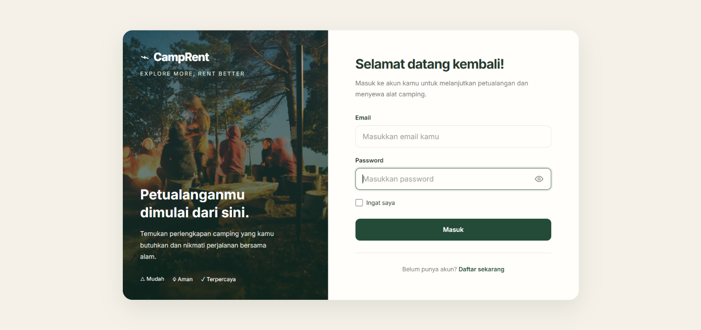
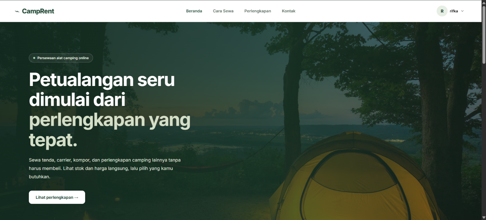
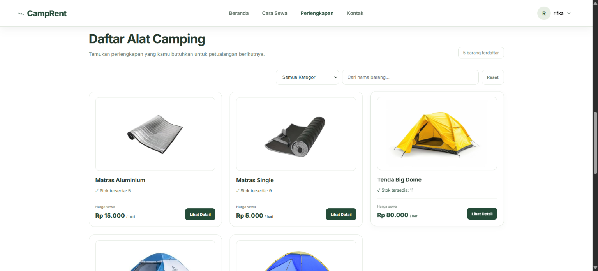
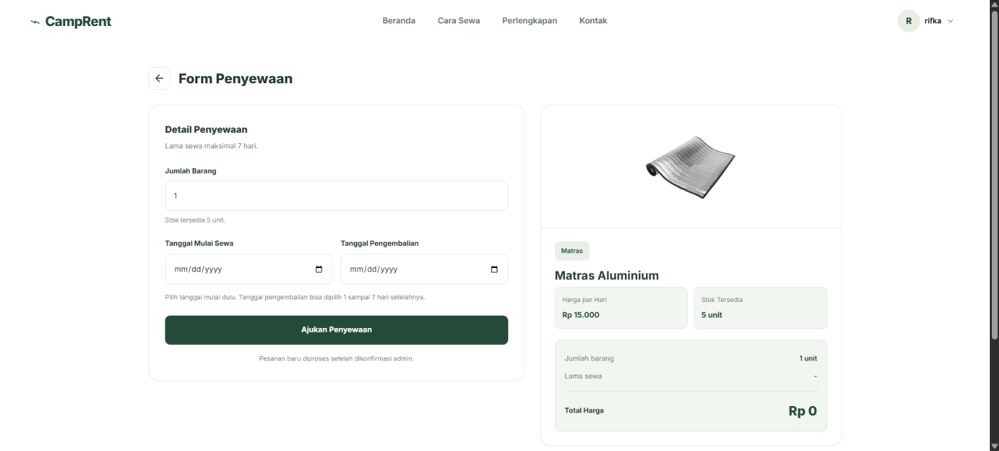
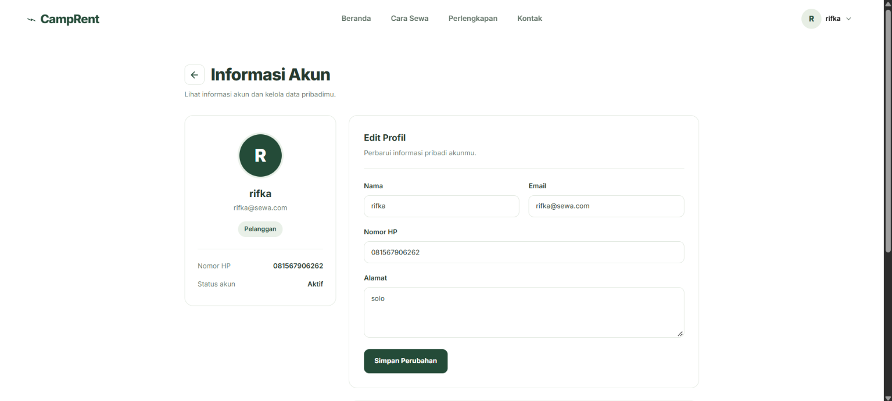
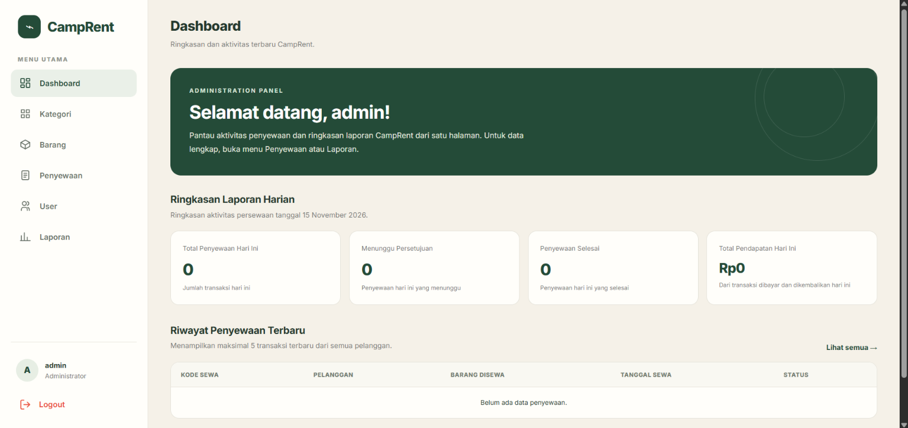
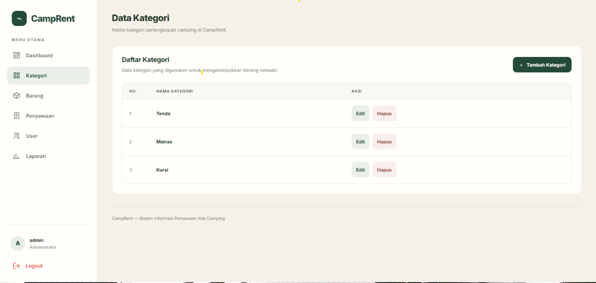
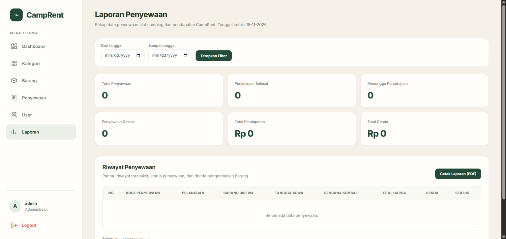
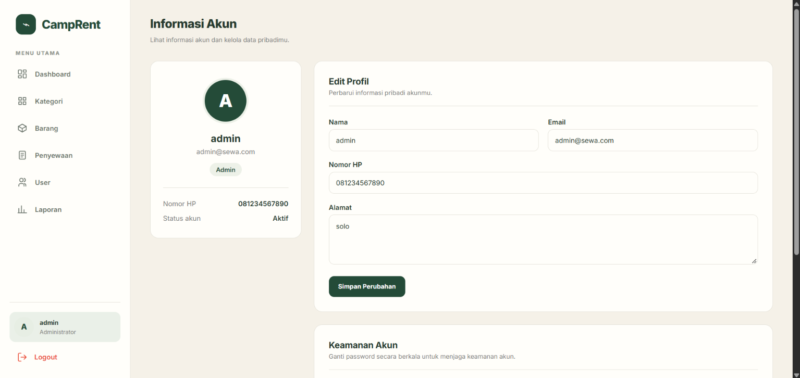
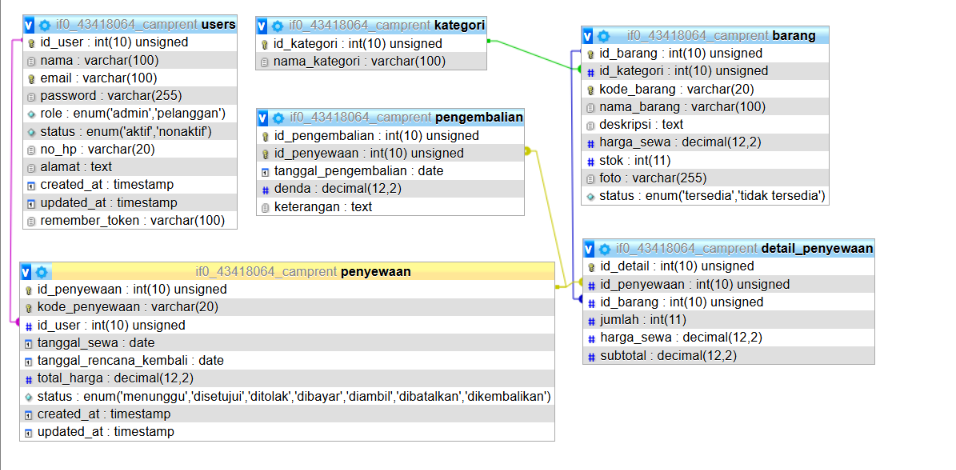

# CampRent – Sistem Informasi Persewaan Alat Camping

---

## Deskripsi

CampRent merupakan aplikasi berbasis web yang dikembangkan untuk memudahkan proses persewaan alat camping secara online. Aplikasi ini menyediakan informasi barang camping, ketersediaan stok, proses penyewaan, pembayaran, hingga pengembalian barang.

CampRent memiliki dua jenis pengguna, yaitu **Admin** dan **Pelanggan**, dengan hak akses dan fitur yang berbeda.

## Fitur Aplikasi

### Admin
- Dashboard admin
- Mengelola data kategori
- Mengelola data barang
- Mengelola data penyewaan
- Konfirmasi pembayaran
- Konfirmasi pengambian barang
- Mengelola pengembalian barang
- Mengelola laporan penyewaan
- Mengelola akun pengguna

### Pelanggan (User)
- Registrasi dan login
- Melihat daftar barang camping
- Melihat detail barang
- Melakukan penyewaan barang
- Melihat status penyewaan
- Melihat riwayat penyewaan
- Melihat informasi akun

## Teknologi yang Digunakan

| Teknologi | Keterangan |
|---|---|
| Laravel | Framework backend |
| PHP | Bahasa pemrograman |
| MySQL | Database |
| HTML | Struktur halaman |
| CSS | Styling tampilan |
| JavaScript | Interaksi halaman |

## Screenshot Aplikasi

### Halaman Login dan Register

<table width="100%">
  <tr>
    <th width="50%">Login</th>
    <th width="50%">Register</th>
  </tr>
  <tr>
    <td align="center">
      
    </td>
    <td align="center">
      
    </td>
  </tr>
</table>

### 1. Tampilan Pelanggan (User)

<table width="100%">
  <tr>
    <th width="50%">Beranda</th>
    <th width="50%">Daftar Barang</th>
  </tr>
  <tr>
    <td></td>
    <td></td>
  </tr>
  <tr>
    <th>Detail Barang</th>
    <th>Penyewaan</th>
  </tr>
  <tr>
    <td></td>
    <td></td>
  </tr>
  <tr>
    <th>Riwayat Penyewaan</th>
    <th>Informasi Akun</th>
  </tr>
  <tr>
    <td></td>
    <td></td>
  </tr>
</table>

### 2. Tampilan Admin

<table width="100%">
  <tr>
    <th width="50%">Dashboard Admin</th>
    <th width="50%">Kelola Kategori</th>
  </tr>
  <tr>
    <td></td>
    <td></td>
  </tr>
  <tr>
    <th>Kelola Barang</th>
    <th>Data Penyewaan</th>
  </tr>
  <tr>
    <td></td>
    <td></td>
  </tr>
  <tr>
    <th>Kelola Akun</th>
    <th>Laporan Penyewaan</th>
  </tr>
  <tr>
    <td></td>
    <td></td>
  </tr>
  <tr>
    <th colspan="2">Informasi Akun Admin</th>
  </tr>
  <tr>
    <td colspan="2" align="center">
      
    </td>
  </tr>
</table>

## Entity Relationship Diagram (ERD)

ERD berikut menggambarkan hubungan antar tabel dalam database CampRent.



## Instalasi dan Menjalankan Project

### Persyaratan
- PHP
- Composer
- MySQL
- Node.js dan NPM
- Git

### Langkah Instalasi

**1. Clone repository**

```bash
git clone https://github.com/anggunrifka2009-lab/web_persewaan_camping.git
```

**2. Masuk ke direktori project**

```bash
cd web_persewaan_camping
```

**3. Install dependency Laravel**

```bash
composer install
```

**4. Install dependency frontend**

```bash
npm install
```

**5. Salin file environment**

```bash
cp .env.example .env
```

**6. Generate application key**

```bash
php artisan key:generate
```

**7. Buat database MySQL**

Buat database dengan nama `persewaan_camping`, kemudian sesuaikan konfigurasi pada file `.env`.

```env
DB_CONNECTION=mysql
DB_HOST=127.0.0.1
DB_PORT=3306
DB_DATABASE=persewaan_camping
DB_USERNAME=root
DB_PASSWORD=
```

**8. Jalankan migrasi database**

```bash
php artisan migrate
```

Jika tersedia seeder:

```bash
php artisan db:seed
```

**9. Hubungkan storage**

```bash
php artisan storage:link
```

**10. Jalankan aplikasi**

Terminal pertama:

```bash
npm run dev
```

Terminal kedua:

```bash
php artisan serve
```

Buka browser melalui:

```text
http://127.0.0.1:8000
```

## Akun Demo

Gunakan akun berikut untuk mencoba aplikasi.

| Role | Email | Password |
|---|---|---|
| Admin | admin@sewa.com | 12345678 |
| Pelanggan | user@sewa.com | 12345678 |

---

<p align="center">
  © 2026 CampRent. All Rights Reserved.
</p>